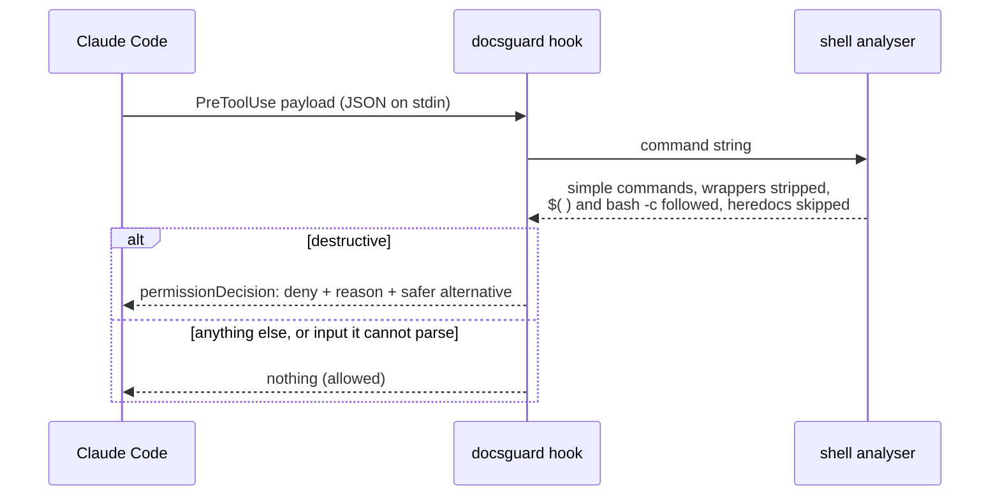

# docsguard

**Executable guards for project-oriented documentation and Claude Code workflows.**

Documentation that guides an AI coding session decays the way all documentation does, and an out-of-date map costs more
than no map: the session either loads everything "to be safe" or trusts something false. This project turns the
conventions that keep such a system healthy into checks that **fail the build**, and ships the two hooks that enforce
what a markdown file can only request.

```text
$ docsguard check
docsguard 0.1.0: /work/project
  ok claude-entrypoint    1 examined
  ok map-links-live       5 examined
  x  map-complete         9 examined, 1 finding(s)
       [map-complete] docs/runbook.md: not reachable from docs/00-READ-FIRST.md: add it to the map in the same commit that creates it
  ok map-counts           1 examined
  x  adr-shape            1 examined, 1 finding(s)
       [adr-shape] docs/adr/0001-record-architecture-decisions.md: has no '## Rejected alternatives' section: an ADR records what lost, and why
  ok handoff-shape        8 examined
  ok instruction-budget   3 examined
  ok skill-shape          3 examined
  ok no-secrets           19 examined
FAILED: 2 problem(s)
```

Python 3.11+, **standard library only**, `mypy --strict`, 337 tests, and every guard is checked by a mutation script that
breaks it on purpose.

## What is in the box

| Part | What it does |
| --- | --- |
| `docsguard check` | Nine guards over the documentation system, plus `--staged` for the same-commit rule |
| `docsguard budget` | What a session pays up front, against reading every document, measured on your repository |
| `docsguard hook git-guard` | A `PreToolUse` hook that refuses git commands which destroy unrecoverable work |
| `docsguard hook scope-guard` | A `PreToolUse` hook that refuses writes to protected paths unless a committed line says why |
| `docsguard init` | A template (CLAUDE.md, AGENTS.md, docs map, ADRs, handoff, skills, agent contracts, bridge protocol) that **passes its own guards** |
| `scripts/sabotage.py` | Mutation proof: 60 mutants, each must turn its test red with an assertion failure |

## Quick start

```bash
pip install .                        # or: pipx install git+https://github.com/MenoDK/docsguard  (no runtime dependencies)
docsguard init ./my-project --name my-project
docsguard check --root ./my-project  # green on a fresh template
docsguard budget --root ./my-project
```

Wire the hooks by committing `.claude/settings.json` (the template already has it). The command does nothing when
`docsguard` is not installed, so a teammate without it gets no error on every tool call:

```json
{
  "hooks": {
    "PreToolUse": [
      {
        "matcher": "Bash",
        "hooks": [{ "type": "command", "command": "command -v docsguard >/dev/null 2>&1 || exit 0; docsguard hook git-guard" }]
      },
      {
        "matcher": "Bash|Edit|Write|MultiEdit|NotebookEdit",
        "hooks": [{ "type": "command", "command": "command -v docsguard >/dev/null 2>&1 || exit 0; docsguard hook scope-guard" }]
      }
    ]
  }
}
```

Without installing anything, in a container (the target is mounted read-only, no network, no capabilities; the image has no git, so `--staged` reports an explicit skip there):

```bash
TARGET=/path/to/repo docker compose run --rm check
```

In CI, as an action: `uses: MenoDK/docsguard@main` with `root: .` (and `staged: true` on pull requests).

## How a session is meant to start


Red is paid on every session and is therefore budgeted; green is opened only when its row applies. `docsguard budget` on
this repository, measured:

| | tokens (estimated) |
| --- | ---: |
| Session start (CLAUDE.md, AGENTS.md, one rule) | ~1,171 |
| A typical start: the above plus the map and the handoff | ~1,989 |
| Reading every document instead | ~7,120 |

A typical start is about 28% of reading everything, on a small repository. The ratio improves with the size of the
documentation, because the start does not grow and the total does. Token counts are `characters / 4` and are labelled
as estimates wherever they are printed ([ADR 0004](docs/adr/0004-token-estimate-by-characters.md)).

## The guards

| Guard | Fails when |
| --- | --- |
| `claude-entrypoint` | `CLAUDE.md` is missing or does not point at the docs map |
| `map-links-live` | a link in the map does not resolve |
| `map-complete` | a document under `docs/` is not reachable from the map (only index files fan out, so a plain document cannot launder an orphan) |
| `map-counts` | a count the map declares (`<!-- docsguard:count dir=docs/adr glob=0*.md expect=6 -->`) differs from the disk |
| `adr-shape` | an ADR lacks status, context, decision or **rejected alternatives**; numbering has a gap or duplicate; the index omits a record |
| `handoff-shape` | the handoff lacks its eight sections, a real date, or a **number** in "suite state"; decisions cite no ADR |
| `instruction-budget` | a file loaded at session start exceeds its line cap, or the set exceeds the token budget |
| `skill-shape` | a skill's name differs from its directory, the description does not say *Use when…* or is invalid YAML, or the body is too large to survive compaction |
| `no-secrets` | a session-facing document contains a key block, token, URL credential or cloud identifier (the match is never printed) |
| `same-commit` | (`--staged`) a commit adds a document without touching the map, or an ADR without the ADR index |

Two properties apply to all of them. **A guard that examined nothing fails** unless it printed an explicit skip with a
reason ([ADR 0005](docs/adr/0005-a-guard-that-examines-nothing-fails.md)). **Every dismissal carries a written reason**, and
a dismissal that stops matching is itself reported ([ADR 0006](docs/adr/0006-dismissals-carry-reasons-and-expire.md)).

## The hooks



```text
[docsguard:force-push] a forced push overwrites remote history. Use `--force-with-lease`, which refuses when someone else pushed.
[docsguard:protected-path] writing .env is blocked by '.env': environment files hold real credentials; edit .env.example instead.
  To allow it, a human adds the line `path:.env -- <why>` to .claude/authorizations.txt and commits it, so the exception is reviewed.
```

`git-guard` denies by class of damage and names the alternative each time: force pushes and remote deletions, `reset --hard`,
`clean -f`, `checkout .` / `restore .`, `branch -D`, `stash drop`, reflog and gc pruning, history rewrites, and bypassing hooks
(`--no-verify`, `-c core.hooksPath=…`). It understands `sudo`, `env`, `timeout`, `bash -c '…'`, `eval`, `a && b`, `$(…)` and
backticks, and it does **not** flag a commit message that merely mentions `git reset --hard`. `git push --force-with-lease`,
`git clean -n`, `git restore --staged .` and `git branch -d` are allowed. The full table is in `tests/test_git_guard.py`.

`scope-guard` never blocks reads. It blocks writes (editor tools, and shell redirections, `tee`, `rm`, `mv`, `cp`, `sed -i`,
`dd of=`) to secrets, keys, `.git/` and any path you list under `[[scope.protected]]`. Symlinks and `..` are resolved first.

**What these hooks are not.** They prevent accidents, not attacks. Variables, `base64 | sh`, aliases and a script written
and then run all defeat any scanner of this kind; real boundaries (permissions, sandboxes, branch protection) stay in
place underneath ([ADR 0003](docs/adr/0003-hooks-denylist-and-fail-open.md)). Input the hook cannot parse is allowed, and a
broken configuration exits 1 (a visible, non-blocking error), never 2.

## How the guards were checked

A check that has never been seen failing proves nothing, so `scripts/sabotage.py` removes or inverts one decision at a
time and requires the matching test file to go red. Three details make the report honest:

- Only pytest **exit code 1** (a test failed) counts as "killed". A mutant that merely breaks the syntax gives exit 2 and is
  reported `INVALID`: it proves nothing about the tests.
- The unmutated suite must be green first.
- The source tree is hashed before and after; the script exits non-zero if it is not restored byte for byte.

```text
  killed    git-guard: +refspec force push is allowed
              by test_destructive_commands_are_denied_with_the_right_reason[git push origin +main-force-push]
  killed    adr: rejected alternatives not required
              by test_a_rejected_section_that_names_nothing_fails
  ...
source tree restored byte-for-byte; survivors: 0
```

The suite found real problems in its own tests: a "every denial names a safer alternative" test whose condition was always
true (it passed on the first run and tested nothing; five denials had no alternative), a duplicate-number test that accused
the wrong file, and a first mutation report inflated by mutants that only broke the syntax.

## Design decisions

Each has a record with the alternatives that were **rejected**:

| # | Decision |
| --- | --- |
| [0001](docs/adr/0001-record-architecture-decisions.md) | Record architecture decisions |
| [0002](docs/adr/0002-standard-library-only.md) | Standard library only at run time |
| [0003](docs/adr/0003-hooks-denylist-and-fail-open.md) | Hooks are a denylist, fail open, and are not a security boundary |
| [0004](docs/adr/0004-token-estimate-by-characters.md) | Tokens are estimated as characters divided by four |
| [0005](docs/adr/0005-a-guard-that-examines-nothing-fails.md) | A guard that examined nothing fails |
| [0006](docs/adr/0006-dismissals-carry-reasons-and-expire.md) | Every dismissal carries a written reason, and stale ones are reported |

The methods behind the guards (a map instead of content, four living documents, decisions on paper first, bounded
instruction budgets, guards proven by sabotage, compressed subagent contracts, the bridge protocol, a knowledge tree) are
catalogued in [docs/TECHNIQUES.md](docs/TECHNIQUES.md), each with what it prevents and where it is enforced.

## Project layout

```text
src/docsguard/
  rules/          one module per family of guards: docs_map, adr, handoff, budget, skills, secrets, staged
  hooks/          shell.py (command analyser), git_guard.py, scope_guard.py, protocol.py (wire format)
  template/       what `init` installs; dot-claude/ becomes .claude/
  checks.py       runs rules, applies written exemptions, renders the verdict
tests/            one file per module; the good repository is the initialised template
scripts/sabotage.py   mutation proof
docs/             this project's own documentation, held to its own guards (tests/test_dogfood.py)
```

## Development

```bash
make install     # venv + dev tools
make check       # ruff, mypy --strict, pytest, and this repository's own guards
make mutate      # the mutation proof
make docker      # build the image and run the guards on this repository from the container
```

## Limits, stated plainly

- Hooks are not a security boundary (above). Token counts are estimates. Front matter is read as flat keys: nested YAML is
  ignored rather than guessed at ([ADR 0002](docs/adr/0002-standard-library-only.md)).
- The handoff sections are recognised by keywords in their headings, so a heading in another language needs the same
  keywords or a custom section list; this is a heuristic.
- The `@import` and unscoped-rule behaviour mirrors Claude Code's documented behaviour at the time of writing. Check
  the current documentation if the loading rules change.
- The GitHub Actions workflow and `action.yml` are written and linted but have not yet run on GitHub; everything else here
  was run locally, including the image, the built wheel installed into a clean environment, and the mutation script.

MIT licensed.
