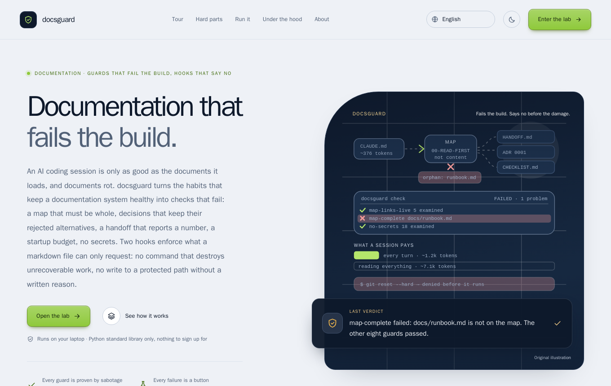
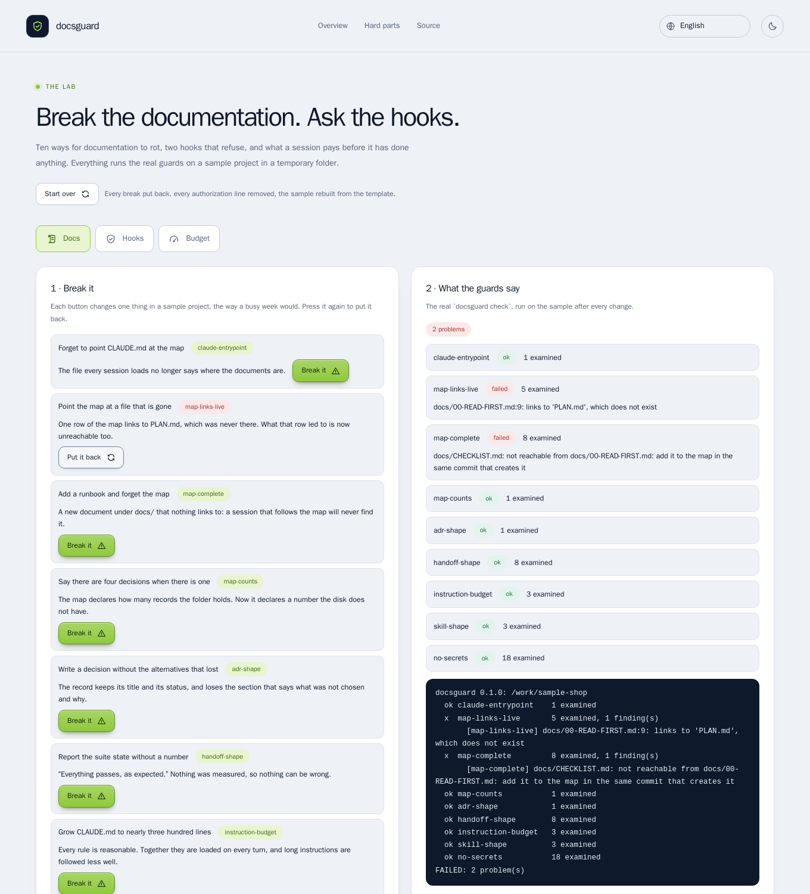
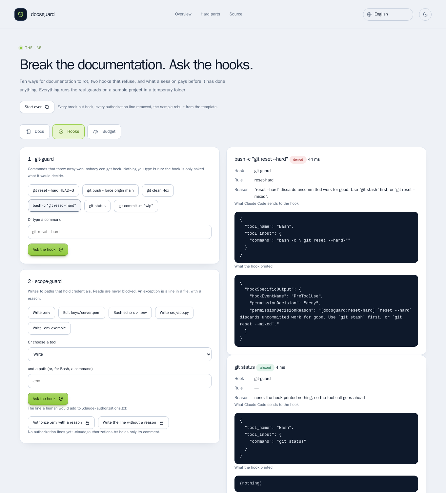
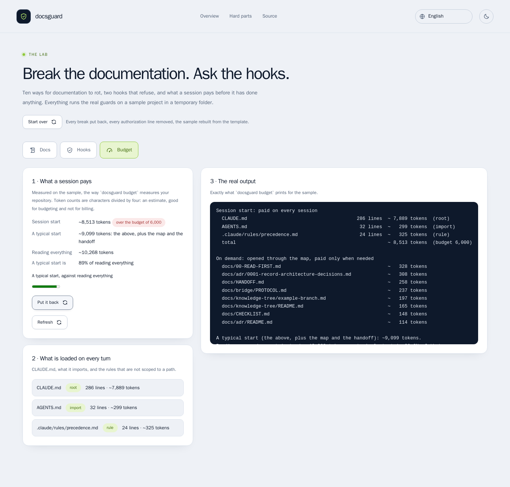
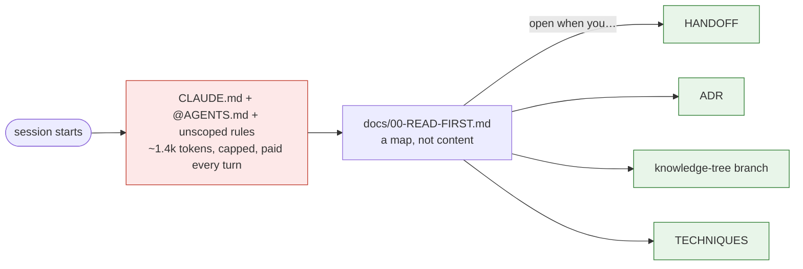
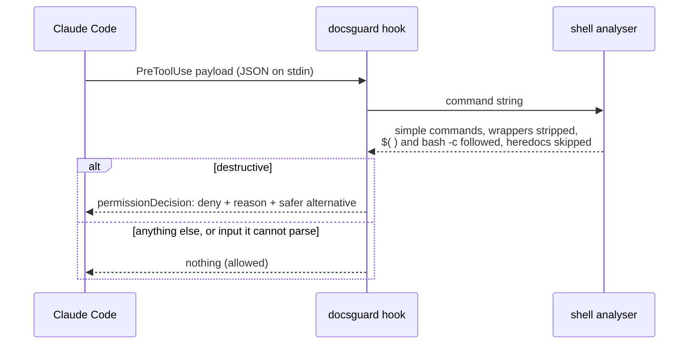
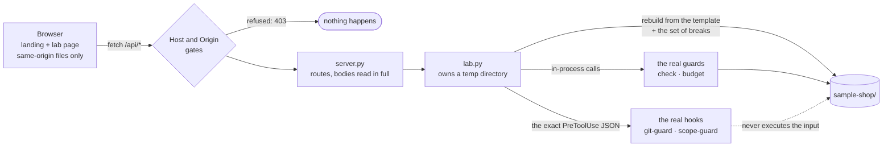

# docsguard

**Documentation that fails the build. Hooks that say no before the damage.**

[](https://github.com/MenoDK/docsguard/actions/workflows/ci.yml)


An AI coding session is only as good as the documents it loads, and documents rot. This project turns the habits that keep
a documentation system healthy into checks that **fail the build**: a map that must be whole, decisions that keep their
rejected alternatives, a handoff that reports a number, a startup budget, no secrets. Two **hooks** enforce what a markdown
file can only request: no command that destroys unrecoverable work, no write to a protected path without a written reason.



## Run it in a minute

You need Docker and `make`. Nothing else, no account, nothing leaves your machine.

```bash
git clone https://github.com/MenoDK/docsguard.git
cd docsguard
make playground        # builds a small image and starts the lab on http://localhost:8200
```

Open **<http://localhost:8200>**. The landing page explains the whole thing (it is in 14 languages: pick one in the top bar),
and **Enter the lab** opens a sample project in a temporary folder that you can break with a button and watch the real
guards notice. `make down` stops it.

Want the tool on your own repository instead, with no Docker? Python 3.11+ and nothing to install but the package:

```bash
pip install .
docsguard init ./my-project --name my-project
docsguard check --root ./my-project
```

## Try to break it

The landing page lists seven hard parts, each with a recipe, what you should see and a button that opens the lab on the
right tab. The short version:

| Try this in the lab | What you should see |
| --- | --- |
| **Docs** · "Add a runbook and forget the map" | `map-complete` fails and names `docs/runbook.md`; the other eight guards stay green; "Put it back" is green again |
| **Docs** · "Point the map at a file that is gone" | `map-links-live` fails, and `map-complete` fails **too**: the checklist was only reachable through that row |
| **Docs** · "Write a decision without the alternatives that lost" + "Report the suite state without a number" | `adr-shape` and `handoff-shape` name what is missing |
| **Docs** · "Paste a cloud access key into the handoff" | `no-secrets` names the file and the pattern, says the value is not shown, and the key is nowhere on the page |
| **Budget** · "Grow CLAUDE.md" | the session start goes from ~1,000 to ~8,500 tokens, over the budget of 6,000, and `instruction-budget` fails twice |
| **Hooks** · `git reset --hard HEAD~3`, then `bash -c "git reset --hard"` | both **denied**, with the JSON Claude Code would send and the JSON the hook printed; `git status` is allowed and the hook prints nothing |
| **Hooks** · "Write .env" → "Write the line without a reason" → "Authorize .env with a reason" | denied; denied again and the answer says a line was ignored because it gave no reason; allowed |

Nothing you type is ever run: a hook is only asked what it would decide ([ADR 0007](docs/adr/0007-the-playground-runs-the-real-guards-and-executes-nothing.md)).

| Docs | Hooks | Budget |
| --- | --- | --- |
|  |  |  |

## What is in the box

| Part | What it does |
| --- | --- |
| `docsguard check` | Nine guards over the documentation system, plus `--staged` for the same-commit rule |
| `docsguard budget` | What a session pays up front, against reading every document, measured on your repository |
| `docsguard hook git-guard` | A `PreToolUse` hook that refuses git commands which destroy unrecoverable work |
| `docsguard hook scope-guard` | A `PreToolUse` hook that refuses writes to protected paths unless a committed line says why |
| `docsguard init` | A template (CLAUDE.md, AGENTS.md, docs map, ADRs, handoff, skills, agent contracts, bridge protocol) that **passes its own guards** |
| `playground/` | The lab: a standard-library server that runs the real guards on a sample project you can break |
| `site/` | The landing page and the lab page, 14 languages, no build step, no third-party request |
| `scripts/sabotage.py` | Mutation proof: 86 mutants (the guards, the hooks and the lab's doors), each must turn its test red |

```text
$ docsguard check
docsguard 0.1.0: /work/project
  ok claude-entrypoint    1 examined
  ok map-links-live       5 examined
  x  map-complete         9 examined, 1 finding(s)
       [map-complete] docs/runbook.md: not reachable from docs/00-READ-FIRST.md: add it to the map in the same commit that creates it
  ok map-counts           1 examined
  x  adr-shape            1 examined, 1 finding(s)
       [adr-shape] docs/adr/0001-record-architecture-decisions.md: has no '## Rejected alternatives' section: an ADR records what lost, and why
  ok handoff-shape        8 examined
  ok instruction-budget   3 examined
  ok skill-shape          3 examined
  ok no-secrets           19 examined
FAILED: 2 problem(s)
```

## Quick start for your own repository

```bash
pip install .                        # or: pipx install git+https://github.com/MenoDK/docsguard  (no runtime dependencies)
docsguard init ./my-project --name my-project
docsguard check --root ./my-project  # green on a fresh template
docsguard budget --root ./my-project
```

Wire the hooks by committing `.claude/settings.json` (the template already has it). The command does nothing when
`docsguard` is not installed, so a teammate without it gets no error on every tool call:

```json
{
  "hooks": {
    "PreToolUse": [
      {
        "matcher": "Bash",
        "hooks": [{ "type": "command", "command": "command -v docsguard >/dev/null 2>&1 || exit 0; docsguard hook git-guard" }]
      },
      {
        "matcher": "Bash|Edit|Write|MultiEdit|NotebookEdit",
        "hooks": [{ "type": "command", "command": "command -v docsguard >/dev/null 2>&1 || exit 0; docsguard hook scope-guard" }]
      }
    ]
  }
}
```

Without installing anything, in a container (the target is mounted read-only, no network, no capabilities; the image has no
git, so `--staged` reports an explicit skip there):

```bash
TARGET=/path/to/repo docker compose run --rm check
```

In CI, as an action: `uses: MenoDK/docsguard@main` with `root: .` (and `staged: true` on pull requests).

## How a session is meant to start



Red is paid on every session and is therefore budgeted; green is opened only when its row applies. `docsguard budget` on
this repository, measured on 2026-11-05:

| | tokens (estimated) |
| --- | ---: |
| Session start (CLAUDE.md, AGENTS.md, one rule) | ~1,389 |
| A typical start: the above plus the map and the handoff | ~2,207 |
| Reading every document instead | ~8,693 |

A typical start is about 25% of reading everything, on a small repository. The ratio improves with the size of the
documentation, because the start does not grow and the total does. Token counts are `characters / 4` and are labelled
as estimates wherever they are printed ([ADR 0004](docs/adr/0004-token-estimate-by-characters.md)).

## The guards

| Guard | Fails when |
| --- | --- |
| `claude-entrypoint` | `CLAUDE.md` is missing or does not point at the docs map |
| `map-links-live` | a link in the map does not resolve |
| `map-complete` | a document under `docs/` is not reachable from the map (only index files fan out, so a plain document cannot launder an orphan) |
| `map-counts` | a count the map declares (`<!-- docsguard:count dir=docs/adr glob=0*.md expect=7 -->`) differs from the disk |
| `adr-shape` | an ADR lacks status, context, decision or **rejected alternatives**; numbering has a gap or duplicate; the index omits a record |
| `handoff-shape` | the handoff lacks its eight sections, a real date, or a **number** in "suite state"; decisions cite no ADR |
| `instruction-budget` | a file loaded at session start exceeds its line cap, or the set exceeds the token budget |
| `skill-shape` | a skill's name differs from its directory, the description does not say *Use when…* or is invalid YAML, or the body is too large to survive compaction |
| `no-secrets` | a session-facing document contains a key block, token, URL credential or cloud identifier (the match is never printed) |
| `same-commit` | (`--staged`) a commit adds a document without touching the map, or an ADR without the ADR index |

Two properties apply to all of them. **A guard that examined nothing fails** unless it printed an explicit skip with a
reason ([ADR 0005](docs/adr/0005-a-guard-that-examines-nothing-fails.md)). **Every dismissal carries a written reason**, and
a dismissal that stops matching is itself reported ([ADR 0006](docs/adr/0006-dismissals-carry-reasons-and-expire.md)).

## The hooks



```text
[docsguard:force-push] a forced push overwrites remote history. Use `--force-with-lease`, which refuses when someone else pushed.
[docsguard:protected-path] writing .env is blocked by '.env': environment files hold real credentials; edit .env.example instead.
  To allow it, a human adds the line `path:.env -- <why>` to .claude/authorizations.txt and commits it, so the exception is reviewed.
```

`git-guard` denies by class of damage and names the alternative each time: force pushes and remote deletions, `reset --hard`,
`clean -f`, `checkout .` / `restore .`, `branch -D`, `stash drop`, reflog and gc pruning, history rewrites, and bypassing hooks
(`--no-verify`, `-c core.hooksPath=…`). It understands `sudo`, `env`, `timeout`, `bash -c '…'`, `eval`, `a && b`, `$(…)` and
backticks, and it does **not** flag a commit message that merely mentions `git reset --hard`. `git push --force-with-lease`,
`git clean -n`, `git restore --staged .` and `git branch -d` are allowed. The full table is in `tests/test_git_guard.py`.

`scope-guard` never blocks reads. It blocks writes (editor tools, and shell redirections, `tee`, `rm`, `mv`, `cp`, `sed -i`,
`dd of=`) to secrets, keys, `.git/` and any path you list under `[[scope.protected]]`. Symlinks and `..` are resolved first.

**What these hooks are not.** They prevent accidents, not attacks. Variables, `base64 | sh`, aliases and a script written
and then run all defeat any scanner of this kind; real boundaries (permissions, sandboxes, branch protection) stay in
place underneath ([ADR 0003](docs/adr/0003-hooks-denylist-and-fail-open.md)). Input the hook cannot parse is allowed, and a
broken configuration exits 1 (a visible, non-blocking error), never 2.

## The lab

The lab is the part of this repository that exists so that you do not have to take any of the above on trust.



- **It runs the real code.** `check` and `budget` are the package's own functions over a real directory; each hook is
  called through its own entry point with the JSON Claude Code would send. There is no second implementation to drift.
- **State is a set, not a history.** The sample is rebuilt from the template plus the set of active breaks and the
  authorization lines written so far, so two breaks on one file cannot undo each other and "Start over" is exact.
- **Two checks keep a web page from driving it**, and neither is a login: the `Host` header must be a name the server
  answers to (that defeats DNS rebinding), and a request that changes something must come from this origin or from no
  browser at all (`Origin`, `Sec-Fetch-Site`). Request bodies are read in full, or the connection is closed, before any answer.
- **The changing endpoints are off unless asked for** (`DG_LAB=1`), and the server refuses to start with them on when it is
  told it is in production. It publishes on the loopback only.
- **The tour on the landing page is recorded from the real command line** by `scripts/record_transcripts.py`, and CI
  records it again and fails if it differs.

| Resource | Value |
| --- | --- |
| Landing page · lab page | <http://localhost:8200> · <http://localhost:8200/lab.html> |
| API (read) | `GET /api/health` · `/api/overview` · `/api/check` · `/api/files` · `/api/budget` |
| API (hooks, always on) | `POST /api/hooks/git` · `/api/hooks/scope` (they only ask what a hook would decide) |
| API (the lab, `DG_LAB=1`) | `POST /api/lab/break` · `/api/lab/authorize` · `/api/lab/reset` (404 otherwise) |
| Image · user | `docsguard-playground:local`, 177 MB · non-root `guard` (uid 10001), read-only root, all capabilities dropped, `/tmp` on tmpfs |
| Environment | `DG_PORT` (8200) · `DG_LAB` · `DG_ENV` · `DG_BIND` · `DG_ALLOWED_HOSTS` · `DG_SITE_DIR`: all in [`.env.example`](.env.example) |
| Memory · dependencies | about 20 MiB at idle (measured with `docker stats`) · none at run time (the browser tests bring their own container) |

## How it was checked

A check that has never been seen failing proves nothing, so `scripts/sabotage.py` removes or inverts one decision at a
time and requires the matching test file to go red. 60 mutants cover the guards and the hooks and 26 cover the lab's doors:
the Host gate, the Origin gate, the production refusal, path traversal, dot-files, file types, the content security policy,
body size and type, the connection staying in step, and the lab's own input limits. Three details make the report honest:

- Only pytest **exit code 1** (a test failed) counts as "killed". A mutant that merely breaks the syntax gives exit 2 and is
  reported `INVALID`: it proves nothing about the tests.
- The unmutated suite must be green first.
- The source tree is hashed before and after; the script exits non-zero if it is not restored byte for byte.

```text
  killed    server: a refused POST is answered before its body is read
              by test_a_refused_post_does_not_poison_the_connection_it_arrived_on
  killed    git-guard: +refspec force push is allowed
              by test_destructive_commands_are_denied_with_the_right_reason[git push origin +main-force-push]
  ...
source tree restored byte-for-byte; survivors: 0
```

| Layer | What | Count |
| --- | --- | ---: |
| `pytest` | guards, hooks, template, the lab's model, the server over a real socket | 451 |
| `scripts/smoke.sh` | every guard and both gates through the running lab's HTTP API | 38 |
| Playwright + axe | landing, lab, 14 languages, light and dark, WCAG A/AA, phone width, no console error, no third-party request | 57 |
| `scripts/sabotage.py` | mutants, each caught | 86 |

The suite found real problems in its own work: a test whose condition was always true (it passed and tested nothing; five
denials had no alternative), a duplicate-number test that accused the wrong file, a first mutation report inflated by mutants
that only broke the syntax, a guard message that read "a AWS access key id", and, only once the browser tests ran against the
container, a refused `POST` that left its body in the connection so the next request on it was parsed from the middle of
the body (the server now reads the body first, or closes the connection; tests over a real socket and mutants pin it).

## Design decisions

Each has a record with the alternatives that were **rejected**:

| # | Decision |
| --- | --- |
| [0001](docs/adr/0001-record-architecture-decisions.md) | Record architecture decisions |
| [0002](docs/adr/0002-standard-library-only.md) | Standard library only at run time |
| [0003](docs/adr/0003-hooks-denylist-and-fail-open.md) | Hooks are a denylist, fail open, and are not a security boundary |
| [0004](docs/adr/0004-token-estimate-by-characters.md) | Tokens are estimated as characters divided by four |
| [0005](docs/adr/0005-a-guard-that-examines-nothing-fails.md) | A guard that examined nothing fails |
| [0006](docs/adr/0006-dismissals-carry-reasons-and-expire.md) | Every dismissal carries a written reason, and stale ones are reported |
| [0007](docs/adr/0007-the-playground-runs-the-real-guards-and-executes-nothing.md) | The playground runs the real guards on a sample it owns and executes nothing it is given |

The methods behind the guards (a map instead of content, four living documents, decisions on paper first, bounded
instruction budgets, guards proven by sabotage, compressed subagent contracts, the bridge protocol, a knowledge tree) are
catalogued in [docs/TECHNIQUES.md](docs/TECHNIQUES.md), each with what it prevents and where it is enforced.

## Project layout

```text
src/docsguard/
  rules/          one module per family of guards: docs_map, adr, handoff, budget, skills, secrets, staged
  hooks/          shell.py (command analyser), git_guard.py, scope_guard.py, protocol.py (wire format)
  template/       what `init` installs; dot-claude/ becomes .claude/
  checks.py       runs rules, applies written exemptions, renders the verdict
playground/       the lab: lab.py (the sample and the questions asked of it), server.py (the doors), __main__.py
site/             landing page and lab page: content.js, lab.js, i18n/ (14 languages), the shared kit
e2e/              Playwright + axe browser tests
tests/            one file per module; the good repository is the initialised template
scripts/          sabotage.py (mutation proof), smoke.sh (black-box), record_transcripts.py (the tour)
docs/             this project's own documentation, held to its own guards (tests/test_dogfood.py)
```

## Development

```bash
make install     # venv + dev tools
make check       # ruff, mypy --strict, pytest, this repository's own guards, and the recorded tour
make mutate      # the mutation proof
make docker      # build the image and run the guards on this repository from the container
make playground  # the lab on http://localhost:8200
make smoke       # black-box checks against the running lab
make e2e         # the browser tests, in a container
```

## Limits, stated plainly

- Hooks are not a security boundary (above). Token counts are estimates. Front matter is read as flat keys: nested YAML is
  ignored rather than guessed at ([ADR 0002](docs/adr/0002-standard-library-only.md)).
- The handoff sections are recognised by keywords in their headings, so a heading in another language needs the same
  keywords or a custom section list; this is a heuristic.
- The `@import` and unscoped-rule behaviour mirrors Claude Code's documented behaviour at the time of writing. Check
  the current documentation if the loading rules change.
- The lab is single-user by design, has no login on purpose, and is meant for the loopback. Do not publish it.
- The landing page and the lab are translated into 13 languages by machine; the English text is the source. A review by a
  native speaker is still owed, most of all for Hindi, Bengali, Urdu and Arabic.
- `action.yml` is written and linted but has not yet run from another repository.

MIT licensed.
